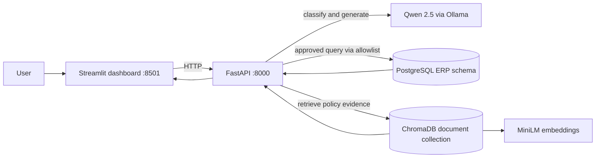

# ERP Business Intelligence Assistant

Ask questions about ERP sales, purchasing, inventory, and policies in plain English. The application combines reviewed, read-only SQL analytics with cited document retrieval and a local Ollama model, exposed through a FastAPI service and a Streamlit dashboard.

> **Scope:** This is a local development and QA-verified project, not a production deployment. The documented pytest results exclude the PostgreSQL integration test module.

## The business problem

Business teams often need an analyst to run a query or locate an internal policy before they can answer everyday questions such as “How many purchase orders are pending?”, “Which products need reordering?”, or “What is the return window?”

This assistant lets users ask those questions directly while keeping the sources distinct:

- Business figures come from a fixed allowlist of reviewed PostgreSQL analytics queries; the model cannot generate or execute SQL.
- Policy explanations come from retrieved documents in ChromaDB and include source citations.
- A hybrid request combines both evidence types.

Two important data-quality cases are handled explicitly: order-header money must not be summed once per joined line, and a product with no inventory record has unknown stock, not zero stock.

## Architecture



| Component | Responsibility |
|---|---|
| Streamlit | Six-page user interface for overview, assistant, analytics, documents, history, and evaluation. |
| FastAPI | `/chat`, approved analytics, document upload, health, history, and evaluation APIs. |
| PostgreSQL | Structured ERP records for customers, products, sales, inventory, and purchase orders. |
| Approved SQL analytics | Eight named, reviewed queries; the model selects a query name but never supplies SQL text. |
| ChromaDB | Persistent vector collection for policy and reference documents. |
| MiniLM | Chroma's bundled all-MiniLM-L6-v2 embedding function; the configured default is local and is not silently replaced. |
| Qwen 2.5 via Ollama | Local question classification and evidence-based response generation; default model `qwen2.5:1.5b`. |

The API assembles evidence before answer generation. It reports SQL results, citations, route, warnings, and availability separately. Numeric answer checks compare stated figures with the evidence; this does not prove that every non-numeric sentence is factually correct.

## Query routes

| Route | Used for | Example |
|---|---|---|
| **SQL** | A business figure/list covered by one approved query. | “How many purchase orders are pending?” |
| **RAG** | Policy or definition questions answered from the document corpus. Results include document and section citations. | “What is the inventory safety stock policy?” |
| **Hybrid** | A request needing both a structured result and the policy that explains it. | “Which products need reordering, and what does the inventory policy say about reorder points?” |

Requests that match neither an approved analytics query nor the available documents are refused rather than answered with a guessed source. A `.md` or `.txt` filename in a question is treated as an explicit document reference.

## Dashboard features

1. **Overview** — component health, live sales revenue when the API is available, and labeled local CSV snapshot counts.
2. **AI Assistant** — SQL, RAG, and hybrid conversations with route labels, SQL evidence, citations, warnings, and unverified-figure reporting.
3. **Business Analytics** — all eight approved queries, charts, and tables; exact database strings are retained for monetary values.
4. **Documents** — list corpus status and upload UTF-8 `.md`/`.txt` documents up to 2 MB for indexing.
5. **History** — browse conversation sessions held by the current API process.
6. **Evaluation & Performance** — seven metrics, sample counts, route/tester summaries, feedback, charts, and CSV export.

### Approved analytics queries

- `total_sales_revenue`
- `top_products_by_revenue`
- `top_customers_by_revenue`
- `products_below_safety_stock`
- `products_needing_reorder`
- `pending_purchase_order_count`
- `pending_purchase_order_value`
- `monthly_sales_trends`

### Dataset and metric grain

The application can load seven Microsoft AdventureWorks CSV files: SalesOrderHeader, SalesOrderDetail, Customer, Product, ProductInventory, PurchaseOrderHeader, and PurchaseOrderDetail. The source files are operator-provided and are not included in the repository. The loader transforms them into the PostgreSQL `erp` schema. Policy and reference text is a separate document corpus indexed in ChromaDB; it is not part of the structured CSV data. No dataset files or data-derived sample totals are included here.

These are observed QA dataset results, not a claim about a live production business.

**Metric grain matters:** `sales_order.total_due` is one value per sales order; `sales_order_line.line_total` is one value per order line. They answer different questions and must not be summed together after a one-to-many join. Purchase-order value/count metrics are at order grain; product revenue is at line grain; inventory checks use recorded product-inventory quantities. Products without an inventory record have unknown stock, not zero, and are excluded from stock-alert counts. The dashboard overview also labels which values come from the live database and which are local CSV snapshots.

## Technology

- Python 3.10+
- FastAPI, Pydantic, psycopg 3
- PostgreSQL
- Streamlit, pandas, requests, Plotly
- Ollama with Qwen 2.5
- ChromaDB with bundled MiniLM embeddings
- JSONL evaluation storage

## Installation (Windows)

### Prerequisites

- Python 3.10 or later
- PostgreSQL, with the project database and dataset provisioned
- Ollama installed and running locally
- The configured chat model available locally

Clone the repository, create the virtual environment, install the API, dashboard, and development dependencies, and create a local environment file:

```powershell
git clone https://github.com/Reddiah16/Erp-llm-intelligence-rag.git
Set-Location erp-llm-intelligence-rag

python -m venv .venv
.\.venv\Scripts\python.exe -m pip install -r requirements.api.txt
.\.venv\Scripts\python.exe -m pip install -r requirements.dashboard.txt
.\.venv\Scripts\python.exe -m pip install -r requirements.dev.txt

Copy-Item .env.example .env
```

Edit `.env` on your machine and set `POSTGRES_PASSWORD` to the local database password. **Do not put real credentials in README, screenshots, source control, or shared logs.** `.env.example` contains a placeholder password. Configuration names are listed below; see `.env.example` for descriptions and defaults. Never copy a real value into documentation.

### Environment variables

| Purpose | Variable names |
|---|---|
| PostgreSQL connection | `POSTGRES_HOST`, `POSTGRES_PORT`, `POSTGRES_DB`, `POSTGRES_USER`, `POSTGRES_PASSWORD` |
| Ollama chat and routing | `OLLAMA_BASE_URL`, `OLLAMA_MODEL`, `OLLAMA_ROUTE_MODEL`, `OLLAMA_REQUEST_TIMEOUT` |
| RAG embeddings and retrieval | `RAG_EMBEDDING_PROVIDER`, `OLLAMA_EMBED_MODEL`, `RAG_TOP_K` |
| Assistant limits and caching | `AI_MAX_ROWS_IN_CONTEXT`, `AI_MAX_ANSWER_ROWS`, `AI_LIMIT_CEILING`, `AI_MAX_OUTPUT_TOKENS`, `AI_AVAILABILITY_TTL` |
| Documents and ChromaDB | `DOCUMENTS_DIR`, `CHROMA_PATH`, `DOCUMENT_COLLECTION` |
| Optional retrieval-metrics tracking | `MLFLOW_TRACKING_URI` |
| Dashboard API URL override | `ERP_API_URL` |

Place the canonical AdventureWorks source files in the expected locations:

```text
data/sd/SalesOrderHeader.csv
data/sd/SalesOrderDetail.csv
data/sd/Customer.csv
data/sd/Product.csv
data/mm/ProductInventory.csv
data/mm/PurchaseOrderHeader.csv
data/mm/PurchaseOrderDetail.csv
```

Provision PostgreSQL and load/migrate data following the scripts under `db/` and `src/db/`. Do not use any reset option on a database containing data you need to preserve. The canonical CSV source is [Microsoft AdventureWorks oltp-install-script](https://github.com/Microsoft/sql-server-samples/tree/master/samples/databases/adventure-works/oltp-install-script).

Start Ollama and make sure the configured model is already installed:

```powershell
ollama serve
ollama list
```

The default chat and routing model is `qwen2.5:1.5b`. Model installation/download is intentionally not run by this setup guide; obtain models only with the operator's approval. By default, ChromaDB uses its bundled MiniLM embedding function. Embeddings are initialized when ingestion/retrieval first needs them. `RAG_EMBEDDING_PROVIDER` and the optional Ollama embedding configuration are described in `.env.example`.

To index documents from `documents/` when setting up or after changing the corpus:

```powershell
.\.venv\Scripts\python.exe -m src.rag.documents
```

## Run the application

Start each service in its own PowerShell terminal from the repository root.

**Terminal 1 — FastAPI**

```powershell
.\.venv\Scripts\python.exe -m uvicorn api.main:app --host 127.0.0.1 --port 8000
```

**Terminal 2 — Streamlit**

```powershell
.\.venv\Scripts\python.exe -m streamlit run dashboard/app.py --server.port 8501
```

Open:

- Dashboard: [http://localhost:8501](http://localhost:8501)
- API health: [http://localhost:8000/health](http://localhost:8000/health)
- Interactive API docs: [http://localhost:8000/docs](http://localhost:8000/docs)

The dashboard uses `http://localhost:8000` by default. Override it with `ERP_API_URL` if needed.

## API endpoints

| Method | Endpoint | Purpose |
|---|---|---|
| `GET` | `/health` | PostgreSQL, model, document-store, embedding-provider, and approved-query status. |
| `POST` | `/chat` | Classify and answer a question using an approved route; returns evidence, citations, warnings, and session/evaluation identifiers. |
| `GET` | `/analytics` | Run all approved analytics; `?question=<query_name>` selects one and `?limit=N` requests a bounded row limit. |
| `POST` | `/documents/upload` | Validate, store, chunk, and index one `.md`/`.txt` document. |
| `GET` | `/history` | Read a session transcript; `include_sessions=true` opts into the session list. |
| `POST` | `/query` | Legacy row-record retrieval endpoint. |
| `POST` | `/feedback` | Attach helpfulness, correctness, and citation feedback to a chat turn. |
| `GET` | `/evaluation/metrics` | Seven evaluation metrics and sample counts. |
| `GET` | `/evaluation/suggested-questions` | Curated questions and anonymous tester labels. |
| `GET` | `/evaluation/export` | Export recorded evaluation turns and feedback as CSV. |

## Evaluation methodology and provenance

| Metric | Formula |
|---|---|
| Answer accuracy | Correct “yes” / (correct “yes” + correct “no”); “not sure” is excluded. |
| SQL execution success | Successful executions / total SQL executions. |
| Response latency | Arithmetic mean of recorded response times in milliseconds. |
| Retrieval accuracy | Relevant citations / (relevant + irrelevant citation ratings); “not applicable” is excluded. |
| Data grounding | Evidence-supported generated answers / generated SQL, RAG, or hybrid answers. This is a heuristic, not a factuality proof. |
| Cost per query | Mean of recorded API cost; unknown costs are excluded and counted separately. |
| Task completion | Helpful “yes” / (helpful “yes” + helpful “no”). |

Metrics include their sample sizes. Empty denominators are reported as “Not enough data” rather than zero. Local Ollama API cost may be recorded as ₹0; that excludes electricity, hardware, and other infrastructure costs. Evaluation records do not consistently identify whether an interaction came from internal QA, manual testing, or an external pilot. Tester labels are anonymous and do not establish participant type. The aggregate therefore cannot be attributed to any one of these categories; it is not evidence of external-user validation.

## Testing

Run the safe test suite:

```powershell
.\.venv\Scripts\python.exe -m pytest tests -q --ignore=tests\test_db_postgres.py
```

**Local safe-suite result (2026-11-08): 477 passed, 0 failed, 0 skipped.** `tests\test_db_postgres.py` was excluded because it performs PostgreSQL integration tests. The test suite uses fakes and temporary stores where applicable; this result does not imply a production deployment. GitHub Actions successfully built both API and dashboard Docker images. Local Docker Compose runtime testing has not been verified.

## Screenshots

Screenshots are omitted from this publication candidate pending review of data-derived content and redistribution rights.

## Repository structure

```text
api/                 FastAPI application
dashboard/           Streamlit dashboard
data/sd/, data/mm/   Source AdventureWorks CSVs
db/                  PostgreSQL schema, views, and setup scripts
documents/            Curated policy corpus; local uploads are git-ignored
docs/screenshots/    Application screenshots
src/ai/               Routing, assistant, LLM, and SQL allowlist
src/db/               Database configuration and migration utilities
src/evaluation/       Evaluation metrics and pilot feedback storage
src/rag/              Document ingestion, chunking, and retrieval
tests/                Unit, API, dashboard, and integration tests
evaluation_data/      Local evaluation event storage
```

## Limitations and QA status

- **No project license is included.** No express license to reuse or redistribute this project is granted by this repository at this time.
- **Conversation history is in memory.** Restarting FastAPI clears its current transcripts. Evaluation event storage is separate.
- **Evaluation provenance is incomplete.** Records cannot reliably distinguish internal QA, manual testing, and external participants. The dashboard aggregates all records and the metrics are not evidence of an external pilot.
- **Docker runtime remains unverified locally.** GitHub Actions successfully built the API and dashboard images, but the Compose stack has not been started and tested locally.
- **The API has no authentication or authorization.** Run it only on a trusted local machine/network; the Compose configuration publishes service ports and is not a secure public deployment.
- **Model-generated prose can be imperfect.** A verified QA run found a repetitive procurement-policy response. Figure checks and citations do not guarantee every textual statement is correct.
- **Overview counts are partly snapshots.** Order count, inventory counts, and pending-PO count are local CSV-derived values and may lag PostgreSQL; revenue is fetched live when the API is available.
- The assistant is read-only and supports only the approved analytics and available document corpus. Document uploads are limited to UTF-8 Markdown/text files up to 2 MB.
- The MiniLM embedding model may need its one-time cache initialization on first use; no fallback embedding model is silently substituted.

This project demonstrates a source-grounded ERP analytics workflow and has a passing safe test suite. It is not a claim of production readiness, deployed operation, external-pilot validation, or measured impact from external users.
